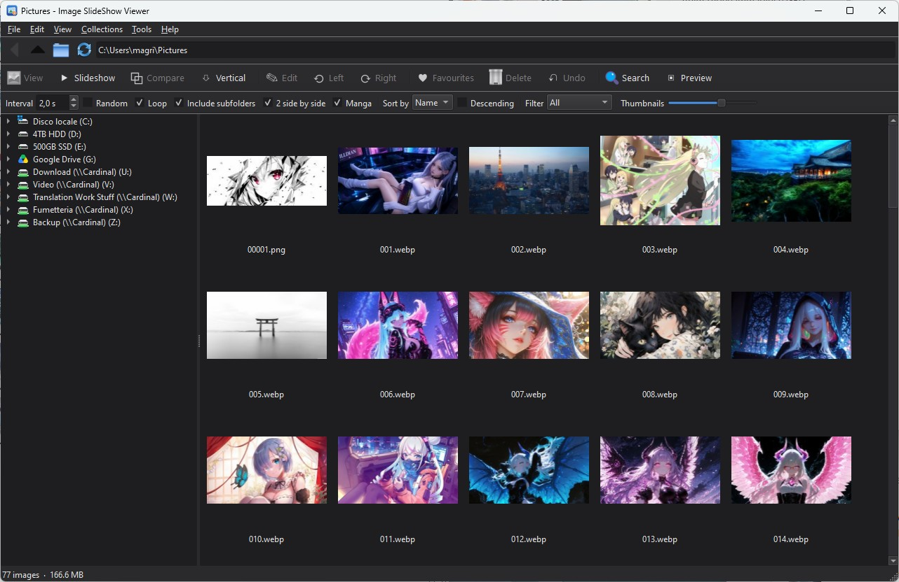

<p align="center"></p>

<h1 align="center">Image SlideShow Viewer</h1>

<p align="center">
Visualizzatore di immagini in stile ACDSee per Windows, macOS e Linux: albero delle cartelle e
browser a miniature, visualizzatore a schermo intero, slideshow che salta da una cartella all'altra,
fumetti (CBZ, CBR, CB7), valutazioni e raccolte, ritocchi rapidi e operazioni in blocco.<br>
<a href="README.md">English</a> · <b>Italiano</b>
</p>

---



---

## Novità della versione 2.0

- **Menu, pulsanti e menu del tasto destro riorganizzati**: ogni comando ha lo stesso nome e lo stesso tasto in tutti e tre i posti, e pulsanti e voci si disattivano da soli quando non servono.
- **Visualizzatore**: rotazione e specchio (salvabili nel file, senza perdita per i JPEG), adatta alla finestra / larghezza / altezza / riempi, lente d'ingrandimento, sfondo nero / grigio / bianco / a scacchi, istogramma, colore del pixel (contagocce).
- **Slideshow**: transizioni (dissolvenza, scorrimento, Ken Burns), musica di sottofondo, scelta dello schermo, smistamento al volo con i tasti 1–9, eliminazione rapida annullabile con Ctrl+Z.
- **Fumetti e manga**: archivi **CBR/RAR** e **CB7/7Z** oltre a CBZ/ZIP, conversione in CBZ, ripresa dall'ultima pagina letta, pagine doppie mostrate da sole, **lettura verticale continua** (webtoon).
- **Organizzare**: **valutazioni a stelle**, **etichette colorate**, **Preferiti e raccolte**, filtro nel browser, **ricerca**, **trova duplicati** (identici o simili), **calendario** per data di scatto, **mappa** delle foto con GPS, **pannello anteprima**.
- **Ritocchi rapidi**: ritaglio con proporzioni fisse, luminosità / contrasto / saturazione / nitidezza, correzione automatica, ridimensionamento.
- **Confronto** di due immagini, affiancate con zoom sincronizzato o con la tendina.
- **Formati**: lettura e scrittura di **HEIC, AVIF e JPEG XL**, anteprima dei **RAW** delle fotocamere, **video brevi** (MP4, WebM, MOV…) che si comportano come le GIF.
- **Tasti personalizzabili**, **salvaschermo**, build automatica su GitHub per **Windows, macOS e Linux**.

## Funzioni

- **Browser** con albero delle cartelle e griglia di miniature (in cache su disco), ordinamento naturale per nome, data o dimensione, filtro per valutazione / etichetta / Preferiti / tipo, pannello anteprima.
- **Visualizzatore** con adatta alla finestra, alla larghezza, all'altezza o riempi lo schermo, zoom, rotazione automatica secondo l'EXIF, rotazione e specchio manuali, lente, istogramma, contagocce, **GIF e WebP animate** e **video**.
- **Slideshow** con intervallo, ordine casuale, ripetizione, sottocartelle e transizioni; **↓ / ↑ saltano alla cartella successiva / precedente** mentre scorre.
- **Fumetti**: archivi CBZ/ZIP, CBR/RAR e CB7/7Z mostrati come cartelle con la copertina, **2 pagine affiancate**, **modalità manga**, lettura verticale continua.
- **Valutazioni, etichette, Preferiti e raccolte**, ricerca, duplicati, calendario e mappa.
- **Rinomina in blocco** sul modello di ACDSee, **conversione in blocco** (JPEG, PNG, WebP, AVIF, HEIC, JPEG XL, TIFF, BMP, GIF), **copia / sposta / elimina** con annullamento.
- **Informazioni immagine ed EXIF**, con la posizione GPS sulla mappa.
- **Slideshow di due cartelle diverse affiancate**.
- **Menu contestuale di Esplora risorse** (facoltativo) e **cartelle di rete** (`\\192.168.0.2`).
- **Accelerazione GPU** (OpenGL) e decodifica JPEG facoltativa su GPU NVIDIA.
- Interfaccia in **italiano e inglese**, tema chiaro / scuro / automatico.

## Requisiti

- Windows 10 o 11, macOS 12 o più recente, oppure Linux (X11 o Wayland)
- Python **3.11 o più recente** (provato con 3.14)
- Le librerie di `requirements.txt`: [PySide6](https://pypi.org/project/PySide6/) 6.8+, [Pillow](https://pypi.org/project/Pillow/) 11.3+ (EXIF, editor, AVIF), [pillow-heif](https://pypi.org/project/pillow-heif/) (HEIC), [pillow-jxl-plugin](https://pypi.org/project/pillow-jxl-plugin/) (JPEG XL), [rawpy](https://pypi.org/project/rawpy/) (RAW), [py7zr](https://pypi.org/project/py7zr/) (7Z/CB7), [rarfile](https://pypi.org/project/rarfile/) (RAR/CBR), [numpy](https://pypi.org/project/numpy/). Tutte tranne PySide6 sono facoltative: se ne manca una, manca solo il formato o la funzione relativa.
- Per **CBR/RAR**: [7-Zip](https://www.7-zip.org) installato (consigliato, legge anche RAR5) oppure UnRAR.
- Con una scheda NVIDIA (Windows e Linux): il supporto per decodificare i JPEG sulla GPU **si scarica dal programma**, che lo propone al primo avvio (vedi *Accelerazione GPU*).

## Installazione

**Versione pronta.** Nella pagina [Releases](https://github.com/LainX84/ImageSlideShowViewer/releases) ci sono i pacchetti per Windows (`.zip`), macOS (`.dmg`, Apple Silicon e Intel) e Linux (`.tar.gz`): estrai e avvia `ImageSlideShowViewer`. Su macOS, al primo avvio fai clic destro sull'app → *Apri*, perché non è firmata da uno sviluppatore Apple.

**Da sorgente.**

1. Installa **Python 3.11 o più recente** da [python.org](https://www.python.org/) (su Windows spunta *"Add Python to PATH"*).
2. Scarica o clona questo repository.
3. Fai doppio clic su **`image_slideshow_viewer.pyw`**. Al primo avvio propone di installare le librerie (qualche minuto), poi apre il programma. Con `.pyw` non compare la finestra nera del terminale; se qualcosa va storto vedi un messaggio d'errore e trovi i dettagli in `image-slideshow-viewer-error.log`.

Da terminale:

```
pip install -r requirements.txt
python image_slideshow_viewer.pyw                 (apre il browser)
python image_slideshow_viewer.pyw D:\Foto         (apre il browser su una cartella)
python image_slideshow_viewer.pyw foto.jpg        (apre subito il visualizzatore)
python image_slideshow_viewer.pyw fumetto.cbz     (apre l'archivio come un fumetto)
python image_slideshow_viewer.pyw --slideshow D:\Foto D:\Fumetti\vol1.cbr
python image_slideshow_viewer.pyw --screensaver D:\Foto
python image_slideshow_viewer.pyw --rename  file1.jpg file2.jpg …
python image_slideshow_viewer.pyw --convert file1.png file2.png …
```

### Creare il programma (.exe / .app) e usarlo come predefinito per le foto

1. Su Windows fai doppio clic su **`build_exe.bat`**; su macOS e Linux esegui **`./build.sh`**. Entrambi usano `packaging/ImageSlideShowViewer.spec` e creano la cartella `dist/` (su Windows `dist\ImageSlideShowViewer\ImageSlideShowViewer.exe`, su macOS `dist/Image SlideShow Viewer.app`).
2. Su Windows sposta l'intera cartella `dist\ImageSlideShowViewer` (non solo il file .exe, che ha bisogno della sottocartella `_internal`) dove preferisci, per esempio `C:\Programmi\ImageSlideShowViewer`.
3. In Esplora risorse fai clic destro su un .jpg, poi *Apri con → Scegli un'altra app → Cerca un'altra app nel PC*, seleziona `ImageSlideShowViewer.exe` e spunta *"Usa sempre"*. Ripeti per .png, .gif, .heic, .cbz, .cbr e così via.

Da quel momento, con un doppio clic su una foto si apre il visualizzatore. **Invio** ti porta al browser su quella cartella, come in ACDSee.

### Build automatica su GitHub

Il workflow `.github/workflows/build.yml` compila il programma per **Windows x64, macOS Apple Silicon, macOS Intel e Linux x64** con Python 3.14 e PyInstaller:

- a ogni push e pull request controlla che il codice si compili e che il programma si avvii;
- con *Actions → Build → Run workflow* crea i pacchetti, che trovi negli *Artifacts* dell'esecuzione;
- con un **tag** che inizia per `v` li pubblica anche come **Release**:

```
git tag v2.0.0
git push origin v2.0.0
```

## Menu contestuale di Esplora risorse

*Strumenti → Menu contestuale di Esplora risorse* aggiunge a Esplora risorse il sottomenu **Image SlideShow Viewer**:

| Clic destro su | Comandi |
|---|---|
| Una cartella, un disco o lo spazio vuoto di una cartella | Avvia slideshow |
| Un archivio `.cbz` / `.zip` / `.cbr` / `.rar` / `.cb7` / `.7z` | Avvia slideshow, Rinomina in blocco |
| Un'immagine (anche HEIC, AVIF, JXL, RAW) o un video | Avvia slideshow, Rinomina in blocco, Converti formato |

- Con più elementi selezionati si apre una sola finestra con tutti (per esempio un unico slideshow su tutte le cartelle selezionate, una dopo l'altra).
- Le voci vengono scritte solo per l'utente corrente (`HKEY_CURRENT_USER\Software\Classes`): non servono permessi di amministratore e togliendo la spunta dalla stessa voce di menu spariscono del tutto.
- Su Windows 11 il sottomenu è sotto **"Mostra altre opzioni"** (oppure Maiusc+F10).
- Se sposti il programma o passi dal `.pyw` all'`.exe`, le voci vengono aggiornate alla successiva apertura del programma. Anche il cambio di lingua le aggiorna.

## Browser

A sinistra c'è l'albero delle cartelle, al centro la griglia (prima le sottocartelle e gli archivi con la copertina, poi immagini e video), a destra o in basso il **pannello anteprima** (F3). Doppio clic o Invio su una cartella per entrarci, Backspace per tornare su. Le miniature restano in cache su disco e la cartella si aggiorna da sola quando i file cambiano.

**Menu, pulsanti e tasto destro usano gli stessi comandi**, con lo stesso nome e lo stesso tasto. Una voce che non si può usare (per esempio *Confronta* senza due immagini selezionate, o *Incolla* con gli appunti vuoti) è disattivata ovunque.

| Menu | Contenuto |
|---|---|
| **File** | Apri cartella, Nuova cartella, Mostra in Esplora risorse, Stampa, Proprietà, Esci |
| **Modifica** | Annulla, Taglia / Copia / Incolla, Seleziona tutto, Rinomina, Modifica immagine, Ruota e specchia (nel file), Valutazione, Etichetta, Preferiti, Copia in / Sposta in, Sposta nel Cestino, Copia percorso, Sfondo del desktop |
| **Visualizza** | Visualizza, Slideshow, Slideshow di 2 cartelle, Lettura verticale, Confronta, Pannello anteprima e sua posizione, Ordina per, Filtro, Informazioni immagine, Aggiorna |
| **Raccolte** | Preferiti e le altre raccolte, Aggiungi la selezione a…, Nuova / Rinomina / Elimina raccolta |
| **Strumenti** | Elaborazione in blocco (Rinomina, Converti formato, Converti archivio in CBZ), Cerca, Trova duplicati, Calendario, Mappa delle foto, Opzioni, Tasti di scelta rapida, Menu di Esplora risorse, Lingua, Tema |
| **Aiuto** | Scorciatoie da tastiera (sempre aggiornate ai tasti impostati), Informazioni su |

La **barra dei pulsanti** ha i comandi più usati: Visualizza, Slideshow, Confronta, Verticale, Modifica, Ruota ⟲ ⟳, Preferiti, Elimina, Annulla, Cerca, Anteprima. Con *Visualizza → Barra dei pulsanti* (o il tasto destro sulla barra) puoi scegliere **pulsanti piccoli, medi o grandi** (icone più grandi con il testo sotto) oppure nasconderla; le icone seguono il colore del tema chiaro o scuro. La barra sotto ha le opzioni dello slideshow, l'ordinamento, il **filtro** (tutte, per numero di stelle, senza valutazione, per etichetta, Preferiti, solo immagini, solo video) e la dimensione delle miniature.

Sulle miniature compaiono le **stelle**, un pallino del colore dell'**etichetta**, un cuore per i **Preferiti** e il simbolo ▶ sui **video**. Selezionando una sola GIF / WebP animata, la sua miniatura si anima.

**Rete:** nella barra del percorso puoi scrivere `\\192.168.0.2` (o il nome del computer) per vedere le sue cartelle condivise, oppure direttamente `\\192.168.0.2\Foto`. Se il computer chiede una password, accedi prima una volta da Esplora risorse.

| Tasto | Azione |
|---|---|
| Invio / doppio clic | Apri la cartella o l'immagine |
| F5, Ctrl+S | Slideshow |
| Maiusc+F5 | Slideshow di 2 cartelle affiancate |
| Ctrl+L | Lettura verticale continua |
| Ctrl+K | Confronta 2 immagini |
| F3 | Pannello anteprima |
| Ctrl+E | Modifica immagine |
| Ctrl+Alt+→ / ← | Ruota a destra / sinistra (nel file) |
| Ctrl+0 … Ctrl+5 | Valutazione da 0 a 5 stelle |
| Alt+0 … Alt+5 | Etichetta (nessuna, rossa, gialla, verde, blu, viola) |
| Ctrl+D | Aggiungi / togli dai Preferiti |
| Ctrl+F | Cerca |
| Ctrl+Z | Annulla l'ultima eliminazione / spostamento |
| F2 / Ctrl+F2 | Rinomina / rinomina in blocco |
| Ctrl+Maiusc+C | Converti formato |
| Ctrl+X / C / V | Taglia / copia / incolla (anche con Esplora risorse) |
| Ctrl+Maiusc+N | Nuova cartella |
| Ctrl+Maiusc+K / M | Copia in… / Sposta in… |
| Ctrl+P | Stampa |
| Alt+Invio | Informazioni immagine ed EXIF (su una cartella: Proprietà) |
| Canc | Sposta nel Cestino (annullabile) |
| Backspace, Alt+↑ / Alt+← | Cartella superiore / Indietro |
| Ctrl+, | Opzioni |
| F1 | Elenco delle scorciatoie |

Tutti i tasti si possono cambiare (vedi *Tasti di scelta rapida*).

## Visualizzatore e slideshow

Le opzioni dello slideshow sono nella barra del browser: **Intervallo**, **Casuale**, **Ripeti**, **Includi sottocartelle**, **2 affiancate** e **Manga**.

- Con **una cartella selezionata** lo slideshow parte da quella e prosegue con tutte le altre cartelle della vista; con **più cartelle selezionate** mostra solo quelle, una dopo l'altra.
- Con **più immagini selezionate** mostra solo quelle; con **una sola** parte da quella. In una raccolta, in una ricerca o con un filtro attivo mostra gli elementi della vista.
- ↓/↑ portano sempre alla cartella successiva/precedente rispetto a quella che stai guardando e **girano in tondo** (dall'ultima si torna alla prima). Senza sottocartelle il salto va alla cartella vicina sul disco che contiene immagini, restando dentro la cartella di primo livello (per esempio `D:\Foto`) o la cartella Immagini.
- Con **Includi sottocartelle** lo slideshow percorre l'albero intero; con *Casuale* mescola sia le cartelle sia le foto.

**Adatta.** Il tasto **W** passa da *adatta alla finestra* ad *adatta alla larghezza* (le pagine lunghe partono dall'alto, la rotellina le scorre e poi passa alla successiva), *adatta all'altezza* e *riempi lo schermo*. **Z** alterna adatta / 100%; Ctrl+rotellina fa lo zoom e trascinando ci si sposta.

**Rotazione.** **R** / **Maiusc+R** ruotano a destra / sinistra, **H** / **Maiusc+H** specchiano. La rotazione resta solo a video finché non premi **Ctrl+S**, che la salva nel file. Per i **JPEG** il salvataggio è **senza perdita**: cambia solo l'orientamento EXIF e i pixel restano identici. Per gli altri formati l'immagine viene salvata di nuovo, con i dati EXIF. Dal browser, *Modifica → Ruota e specchia* ruota più file insieme.

**Strumenti di visione.** **L** lente d'ingrandimento (Maiusc+rotellina cambia l'ingrandimento), **B** colore dello sfondo (nero, grigio, bianco, a scacchi per le parti trasparenti), **G** istogramma, **K** colore del pixel sotto il mouse (coordinate, RGB, esadecimale), **I** informazioni (nome, dimensioni, stelle, etichetta, Preferiti, rotazione).

**Transizioni e musica.** In *Opzioni → Slideshow* scegli la transizione (nessuna, dissolvenza, scorrimento, **Ken Burns**, cioè zoom lento con dissolvenza) e la durata, e una **musica di sottofondo**: un file o una cartella di brani, anche in ordine casuale, con il volume. La musica si ferma con la pausa; **Ctrl+M** la spegne e la riaccende. Lo slideshow può aprirsi su uno **schermo a scelta** (principale, secondario o uno preciso).

**Smistamento al volo.** In *Opzioni → Smistamento* assegni una cartella ai tasti **1–9**: durante lo slideshow o nel visualizzatore il tasto sposta (o copia) l'immagine lì e passa alla successiva. **Ctrl+Z** annulla.

**Eliminazione rapida.** **Canc** sposta l'immagine nel Cestino senza chiedere conferma (la conferma si può riattivare nelle opzioni) e **Ctrl+Z** la rimette al suo posto, anche dopo più eliminazioni. I file passano davvero nel Cestino alla chiusura del programma.

**Valutazioni.** **Ctrl+0…5** stelle, **Alt+0…5** etichetta, **Ctrl+D** Preferiti, anche durante lo slideshow. **E** apre l'editor, **V** la lettura verticale.

| Tasto | Azione |
|---|---|
| → ← , PagGiù/PagSu, rotellina | Immagine successiva / precedente |
| **↓ ↑** , Ctrl+→ / Ctrl+← | **Cartella successiva / precedente** |
| Spazio / P | Avvia o ferma lo slideshow |
| S | Ferma lo slideshow |
| + / − | Intervallo più lungo / più corto (nel visualizzatore: zoom) |
| Home / Fine | Prima / ultima immagine della cartella |
| D / M | 2 affiancate / modalità manga |
| W | Adatta: finestra → larghezza → altezza → riempi |
| Z, *, 0 | Adatta ↔ 100% |
| R / Maiusc+R, H / Maiusc+H | Ruota, specchia (a video) |
| Ctrl+S | Salva la rotazione nel file |
| L, B, G, K | Lente, sfondo, istogramma, colore del pixel |
| I | Informazioni |
| F, F11, doppio clic | Schermo intero |
| 1 … 9 | Smista nella cartella impostata |
| Ctrl+0…5 / Alt+0…5 / Ctrl+D | Stelle / etichetta / Preferiti |
| Canc, Ctrl+Z | Sposta nel Cestino, annulla |
| E, V | Modifica immagine, lettura verticale |
| F2, Ctrl+C, Alt+Invio | Rinomina, copia l'immagine, informazioni EXIF |
| Ctrl+M, A | Musica dello slideshow, audio del video |
| O | Opzioni |
| Invio | Torna al browser su questa immagine (solo nel visualizzatore) |
| Esc | Nello slideshow: esci e torna al browser. Nel visualizzatore: chiudi |

Muovendo il mouse compare in basso una **barra dei comandi** (avvia/ferma, immagine e cartella precedente/successiva, intervallo, ruota, adatta, Preferiti, opzioni). Il **tasto destro** apre un menu con tutti i comandi raggruppati: *Slideshow* (transizione, musica, 2 affiancate, manga), *Visualizzazione* (adatta, zoom, ruota e specchia, sfondo, lente, istogramma, contagocce, schermo intero, lettura verticale), *Valutazione*, *Etichetta*, *Preferiti*, *Aggiungi a raccolta*, *Smista in*, *File* (modifica, rinomina, copia, apri con, sfondo, stampa, mostra in Esplora risorse, copia percorso, EXIF), *Annulla*, *Elimina*, *Opzioni*, *Tasti di scelta rapida*.

### Due immagini affiancate

Con **2 affiancate** spuntato (o il tasto **D** durante lo slideshow) si vedono due immagini alla volta, come le pagine di un libro aperto: 1-2, poi 3-4, 5-6 e così via. Le **pagine doppie** (immagini orizzontali) e i video si mostrano da soli, così le coppie restano allineate (si può disattivare in *Opzioni → Slideshow*). ←/→ vanno avanti e indietro di una coppia, ↓/↑ saltano ancora da una cartella all'altra.

**Modalità manga.** Con **Manga** spuntato (o il tasto **M**) la coppia si legge da destra a sinistra: la 1 a destra e la 2 a sinistra, poi la 3 a destra e la 4 a sinistra. **→** va avanti e **←** torna indietro come sempre.

## GIF e WebP animate, video

- **Visualizzatore**: animazioni e video partono subito, con zoom e spostamento come per le foto.
- **Slideshow**: mentre scorre si vede il primo fotogramma. Con un'immagine alla volta l'animazione parte quando metti in pausa e si ferma sul fotogramma corrente quando riprendi (opzione *Animazione di file GIF e WebP in modalità Slideshow*, attiva di default). Con **2 affiancate** le immagini restano ferme, a meno di attivare *Animazione … con due immagini affiancate*: allora in pausa si animano entrambe.
- **Browser**: selezionando una sola GIF / WebP animata la miniatura si anima; il pannello anteprima anima le GIF e riproduce i video, senza audio.
- I **video** (MP4, M4V, MOV, WebM, MKV, AVI, WMV…) compaiono nel browser con una miniatura e il simbolo ▶ e si comportano come le GIF. Partono senza audio; **A** lo attiva. Si possono nascondere in *Opzioni → Slideshow*.
- Funziona anche con le animazioni dentro gli archivi.

## Fumetti e manga

- **Archivi**: ZIP/CBZ (sempre), **7Z/CB7** (con py7zr, incluso nei requisiti, oppure 7-Zip) e **RAR/CBR** (con 7-Zip installato, che legge anche RAR5, oppure UnRAR). Compaiono come cartelle con la copertina: doppio clic per sfogliarli, oppure selezionali e avvia lo slideshow. RAR e 7Z vengono estratti una volta in una cartella temporanea, che si cancella all'uscita.
- **Converti archivio in CBZ** (*Strumenti → Elaborazione in blocco*, o tasto destro): trasforma CBR/RAR/CB7/7Z nel formato più compatibile, senza ricomprimere le immagini e nello stesso ordine; a scelta, gli originali vanno nel Cestino.
- **Ultima pagina letta**: aprendo di nuovo un archivio dall'inizio (slideshow, lettura verticale o browser) si riparte dalla pagina dove eri rimasto; **Home** torna alla prima.
- **Lettura verticale continua** (**V** nel visualizzatore, **Ctrl+L** nel browser): le pagine una sotto l'altra, da scorrere come un webtoon. Rotellina, ↓/↑, Spazio/PagGiù per una schermata, Home/Fine, **+ / −** (o Ctrl+rotellina) per la larghezza della colonna, F schermo intero, Esc chiude.

## Organizzare le foto

- **Valutazioni** da 0 a 5 stelle (Ctrl+0…5) ed **etichette colorate** (Alt+0…5: nessuna, rossa, gialla, verde, blu, viola), dal browser (anche su più file insieme) o durante lo slideshow.
- **Preferiti e raccolte**: Ctrl+D aggiunge o toglie dai Preferiti. Dal menu **Raccolte** crei raccolte con immagini di cartelle diverse, le apri come una cartella (anche per lo slideshow), le rinomini o le elimini; le immagini restano dove sono.
- **Filtro** nella barra del browser: per stelle, etichetta, Preferiti, solo immagini o solo video.
- **Cerca** (Ctrl+F): nome (anche con `*` e `?`), tipo, intervallo di date (data dello scatto EXIF o del file), dimensioni minime, fotocamera, valutazione, etichetta, con o senza sottocartelle. I risultati compaiono nel browser.
- **Trova duplicati**: file **identici** (stesso contenuto) oppure **simili** (anche ridimensionati, ricompressi o convertiti, con una soglia regolabile). Nei risultati, con le miniature, scegli cosa spostare nel Cestino, anche con *seleziona tutti tranne il più grande / il più vecchio*.
- **Calendario**: le foto della cartella (e delle sottocartelle) per anno, mese e giorno dello scatto; un clic su una data le mostra nel browser.
- **Mappa delle foto**: le foto con la posizione GPS (della selezione o della vista) su una mappa OpenStreetMap nel browser web, con le miniature.

Valutazioni, etichette, raccolte e ultime pagine lette stanno in un piccolo database nella cartella dei dati del programma, quindi le immagini non vengono modificate. I dati seguono i file quando li rinomini o li sposti con il programma.

## Ritocchi rapidi

*Modifica immagine* (**E** nel visualizzatore, **Ctrl+E** nel browser):

- **Ritaglia** trascinando sull'immagine, con proporzioni libere, originali o fisse (1:1, 4:3, 3:2, 16:9, 5:4, 21:9 e verticali) e la regola dei terzi.
- **Ruota e specchia**.
- **Luminosità, contrasto, saturazione, nitidezza** e **correzione automatica** (livelli e contrasto), con anteprima immediata.
- **Ridimensiona** al salvataggio (in pixel o in percentuale, mantenendo le proporzioni).
- **Salva** sovrascrive mantenendo EXIF e profilo colore; **Salva con nome…** permette anche di cambiare formato. *Annulla ultima modifica* torna indietro.

## Confronto di due immagini

Seleziona due immagini e premi **Ctrl+K** (o *Visualizza → Confronta*). Puoi vederle **affiancate**, con zoom e spostamento sincronizzati, oppure con la **tendina**, sovrapposte e divise da una linea da trascinare. Rotellina = zoom sul punto del mouse, trascina = sposta, doppio clic = adatta / 100%, **T** cambia modalità, **S** scambia, Esc chiude.

## Slideshow di 2 cartelle affiancate

*Visualizza → Slideshow di 2 cartelle affiancate…* (Maiusc+F5) mostra due cartelle diverse (o archivi di fumetti) una accanto all'altra, un'immagine per lato. Se nel browser hai selezionato due cartelle, sono già inserite.

- Per ogni lato scegli se **avanza in automatico** con lo slideshow oppure solo **a mano**. Puoi anche partire fermo e avviarlo con Spazio.
- Qui non c'è il salto cartella: quando un lato arriva all'ultima immagine ricomincia dalla prima, quindi la cartella con meno immagini va in loop mentre l'altra prosegue.
- Ordine casuale facoltativo, intervallo regolabile con + / −.

| Tasto | Azione |
|---|---|
| → / ← | Successiva / precedente su entrambi i lati |
| W / Q | Successiva / precedente a sinistra |
| P / O | Successiva / precedente a destra |
| Clic / rotellina su un lato | Successiva (Maiusc+clic: precedente) su quel lato |
| Spazio | Avvia / ferma |
| X | Scambia i lati |
| + / − | Intervallo più lungo / più corto |
| F, I, Esc | Schermo intero, informazioni, chiudi |

Il tasto destro mostra gli stessi comandi e permette di passare ogni lato da automatico a manuale.

## Informazioni immagine (EXIF)

*Visualizza → Informazioni immagine (EXIF)…*, il tasto destro su un'immagine o **Alt+Invio** (nel browser e nel visualizzatore) aprono una finestra con l'anteprima e:

- **File**: nome, cartella (o archivio), dimensione, date di modifica e creazione.
- **Immagine**: formato, dimensioni in pixel, megapixel, modalità colore, DPI, profilo colore, fotogrammi delle animazioni, valutazione, etichetta e Preferiti.
- **Scatto (EXIF)**: fotocamera, obiettivo, data dello scatto, tempo, diaframma, ISO, lunghezza focale, compensazione, flash, orientamento, programma usato, autore, copyright.
- **Posizione GPS** con il pulsante *Mostra sulla mappa* (OpenStreetMap), e l'elenco completo di **tutti i tag EXIF**.

Se l'immagine non ha dati EXIF lo dice e mostra comunque le altre informazioni. *Copia* copia tutto (o le righe selezionate) negli appunti; *Proprietà di Windows…* apre ancora la finestra classica. Durante lo slideshow lo scorrimento si ferma finché la finestra è aperta.

## Opzioni

*Strumenti → Opzioni…* (Ctrl+,) o il tasto **O** nel visualizzatore. Le schede:

- **Avvisi e aspetto**: nome della cartella al cambio (posizione, durata), altri avvisi, indicatore "In pausa", colori e dimensione del testo con anteprima, barra dei comandi.
- **Slideshow**: transizione e durata, zoom del Ken Burns, musica di sottofondo, pagine doppie da sole, ultima pagina letta degli archivi, video sì/no, schermo dello slideshow.
- **Visualizzatore**: eliminazione rapida senza conferma, audio dei video, ingrandimento della lente.
- **Animazioni e GPU**: animazioni (slideshow in pausa, 2 affiancate, miniatura del browser), metodo di disegno, supporto GPU NVIDIA (installa, reinstalla, rimuovi) e decodifica JPEG sulla GPU.
- **Smistamento**: le cartelle dei tasti 1–9, sposta o copia.
- **Salvaschermo**: vedi sotto.
- **Formati**: cosa è disponibile (HEIC, AVIF, JPEG XL, RAW, video, 7Z, RAR) e come aggiungere quello che manca.

## Tasti di scelta rapida

*Strumenti → Tasti di scelta rapida…* elenca tutti i comandi del browser e del visualizzatore con i loro tasti. Doppio clic per cambiarli (fino a 3 alternative); ci sono anche *Nessun tasto*, *Predefinito* e *Ripristina tutti i predefiniti*. Se un tasto è già usato da un altro comando, il programma lo segnala. Menu, barra dei comandi e aiuto (F1) mostrano sempre i tasti impostati.

## Salvaschermo

In *Opzioni → Salvaschermo* puoi far partire, dopo un certo tempo senza usare mouse e tastiera, uno **slideshow casuale a schermo intero** di una cartella (con le sottocartelle e l'intervallo che preferisci). Si chiude muovendo il mouse o premendo un tasto. Funziona mentre il programma è aperto, anche ridotto a icona; da riga di comando: `--screensaver <cartella>`.

## Accelerazione GPU

*Opzioni → Animazioni e GPU → Disegno immagini* (la modifica vale dal riavvio successivo):

| Scelta | Cosa usa |
|---|---|
| **Automatico** (predefinito) | OpenGL della scheda video se disponibile; se c'è solo OpenGL software o nessun OpenGL, la CPU. |
| **GPU – OpenGL della scheda video** | Il driver OpenGL di NVIDIA, AMD o Intel. |
| **OpenGL software** | Mesa llvmpipe (open source, incluso in PySide6): solo per provare se il driver dà problemi. |
| **Solo CPU** | Il metodo delle versioni precedenti. |

Con OpenGL ogni immagine viene caricata una volta nella memoria della scheda video come texture con mipmap: adattamento alla finestra, zoom, spostamento e fotogrammi delle animazioni li calcola la GPU (filtro trilineare con supercampionamento), senza ridimensionare di nuovo l'immagine sulla CPU. Sotto la scelta compare cosa si sta usando (per esempio *OpenGL 4.6 – NVIDIA GeForce …*).

**Decodifica JPEG su GPU NVIDIA** (Windows x64 e Linux x64, libreria proprietaria NVIDIA). Le librerie non sono incluse nel programma, perché servono solo a chi ha una scheda NVIDIA:

- all'avvio, se il programma trova il driver NVIDIA, propone **una volta** di scaricarle: *Scarica e installa*, *Più tardi* (lo richiede al prossimo avvio) o *Non chiedere più*;
- in *Opzioni → Animazioni e GPU → Supporto GPU NVIDIA* si vede la scheda trovata e cosa è installato, con i pulsanti **Installa / Reinstalla** e **Rimuovi**;
- il programma scarica i pacchetti ufficiali `nvidia-nvimgcodec-cu12` e `nvidia-nvjpeg-cu12` da PyPI (circa 25 MB), ne controlla l'impronta SHA-256 e tiene solo il necessario (decoder JPEG per la versione di Python in uso, circa 25 MB su disco) nella cartella dei dati del programma. Non serve pip, quindi funziona anche con il programma compilato;
- dopo l'installazione la decodifica si attiva da sola (*Decodifica i JPEG grandi con la GPU NVIDIA*); dietro un proxy aziendale si può indicare il certificato con la variabile `SSL_CERT_FILE`.

Vale per i JPEG da 512 KB in su; se un file non si decodifica si usa come sempre Qt. Le miniature non ne hanno bisogno: Qt le decodifica già a risoluzione ridotta. Serve un driver NVIDIA recente (CUDA 12). Da sorgente si può usare anche `pip install "nvidia-nvimgcodec-cu12[nvjpeg]"`.

Se con OpenGL qualcosa non va (finestre nere, menu che non compaiono a schermo intero), scegli *Solo CPU*.

## Rinomina in blocco

Seleziona i file (immagini e anche archivi di fumetti) e premi **Ctrl+F2** (o F2 con più file selezionati), oppure usa *Elaborazione in blocco → Rinomina in blocco* dal tasto destro nel browser o in Esplora risorse. Come in ACDSee, la rinomina è un **elenco di operazioni** applicate in ordine: spunta quelle che ti servono, cambiane l'ordine con ↑ / ↓, aggiungine altre con **+** (anche più dello stesso tipo) e toglile con **−**. L'anteprima mostra subito i nuovi nomi.

| Operazione | Cosa fa |
|---|---|
| **Modello** | Nuovo nome da un modello. `*` = nome originale, `#` = contatore (`###` → 001, 002…, oppure aa, ab… con le lettere). Campi: `{nome}`, `{cartella}`, `{data}`, `{ora}`, `{anno}`, `{mese}`, `{giorno}`, `{larghezza}`, `{altezza}` (valgono anche i nomi inglesi `{name}`, `{folder}`, `{date}`…). *Parti da*: valore fisso oppure **rileva automaticamente**, che continua una numerazione già presente nella cartella (Foto_001…Foto_012 → riparte da 013). |
| **Cerca e sostituisci** | Sostituisce tutte le occorrenze. Opzioni: maiuscole/minuscole, includi estensione, espressione regolare (con `\1`, `\2` nel testo sostitutivo). |
| **Maiuscole / minuscole** | Nome: minuscolo, MAIUSCOLO, Iniziali Maiuscole, solo la prima maiuscola. Estensione: minuscola o maiuscola (per uniformare .JPG e .jpg). |
| **Inserisci testo** | All'inizio, alla fine, dopo N caratteri, dopo o prima di un testo. Opzioni: da destra verso sinistra, sovrascrivi i caratteri, includi estensione, maiuscole/minuscole. Il testo può contenere i campi del modello. |
| **Rimuovi testo** | Parte da una posizione o da un delimitatore e toglie un certo numero di caratteri, fino a un delimitatore o fino alla fine. Opzioni: da destra verso sinistra, rimuovi anche i delimitatori, includi estensione, maiuscole/minuscole. |
| **Spazi** | Elimina tutti gli spazi, elimina quelli all'inizio e alla fine, riduce gli spazi doppi, oppure sostituisce gli spazi con un carattere. |

**Avanzate**

- *Se il nuovo nome esiste già*: non rinominare nulla e segnala in rosso, salta quei file, oppure aggiungi un numero (`nome (2)`, `nome (3)`…).
- *Se cambia l'estensione*: consenti oppure salta quei file.

I nomi non validi per Windows (caratteri `< > : " / \ | ? *`, punto o spazio finale, nomi riservati come `CON`) vengono sempre segnalati. Gli scambi di nome (per esempio 1→2, 2→3) sono gestiti correttamente, e funzionano anche i cambi di sole maiuscole (`IMG.JPG` → `img.jpg`). Le operazioni usate restano salvate per la volta successiva.

## Altre operazioni in blocco

- **Converti**: salva in **JPEG, PNG, WebP, AVIF, HEIC, JPEG XL, TIFF, BMP o GIF**, con qualità, modalità **senza perdita** (WebP, AVIF, HEIC, JPEG XL) e riduzione del lato lungo regolabili, in una sottocartella, in un'altra cartella o accanto agli originali. Le foto vengono raddrizzate secondo l'EXIF e i **dati EXIF e il profilo colore vengono conservati**. A scelta, dopo la conversione gli originali vanno nel Cestino.
- **Converti archivio in CBZ**: vedi *Fumetti e manga*.
- **Copia / Sposta** (anche cartelle intere): se un file esiste già nella destinazione, puoi aggiungere un numero al nome, sovrascrivere o saltarlo.
- **Elimina**: sposta file o cartelle nel Cestino; **Ctrl+Z** annulla.

## Tema chiaro / scuro

*Strumenti → Tema*: **Automatico** (segue il tema del sistema, anche mentre il programma è aperto), **Chiaro** o **Scuro**. Il cambio è immediato. Il visualizzatore e lo slideshow usano lo sfondo scelto con il tasto B.

## Lingua

*Strumenti → Lingua / Language*: **Automatica** (come il sistema), **Italiano** o **English**. Il programma propone di riavviarsi per applicare la modifica.

Le traduzioni sono in `isv/lang_en.py`: le chiavi sono i testi italiani usati nel codice. Per aggiungere una lingua basta creare un dizionario analogo e registrarlo in `LANGUAGES` in `isv/i18n.py`.

## Formati

| | Lettura | Scrittura (converti, salva) |
|---|---|---|
| JPEG, PNG, GIF (anche animate), WebP (anche animate), BMP, TIFF | ✓ | ✓ |
| ICO, TGA | ✓ | |
| HEIC / HEIF | ✓ con pillow-heif | ✓ con pillow-heif |
| AVIF | ✓ con Pillow 11.3+ | ✓ con Pillow 11.3+ |
| JPEG XL | ✓ con pillow-jxl-plugin | ✓ con pillow-jxl-plugin |
| RAW (CR2, CR3, NEF, ARW, DNG, ORF, RW2, RAF, PEF…) | anteprima incorporata (meglio con rawpy) | |
| Video (MP4, M4V, MOV, WebM, MKV, AVI, WMV, MPG, 3GP) | ✓ con QtMultimedia (incluso in PySide6) | |
| Archivi ZIP/CBZ | ✓ | ✓ (converti in CBZ) |
| Archivi 7Z/CB7 | ✓ con py7zr o 7-Zip | |
| Archivi RAR/CBR | ✓ con 7-Zip o UnRAR | |

Le foto vengono ruotate automaticamente secondo l'EXIF. *Opzioni → Formati* mostra cosa è disponibile sul tuo computer.

## Struttura

```
image_slideshow_viewer.pyw   avvio (doppio clic)
build_exe.bat, build.sh      creano il programma con PyInstaller
packaging/                   configurazione di PyInstaller, file .desktop per Linux
.github/workflows/build.yml  build automatica Windows / macOS / Linux e Release
isv/__init__.py              nome, versione, autore
isv/app.py                   avvio, riga di comando, coordinamento finestre, schermo, salvaschermo
isv/browser.py               finestra principale: albero, miniature, menu, pulsanti, tasto destro
isv/shortcuts.py             elenco dei comandi e dei tasti (personalizzabili), aiuto F1
isv/thumbs.py                miniature, cache su disco, stelle / etichette / video
isv/preview.py               pannello anteprima del browser
isv/viewer.py                visualizzatore e slideshow (comandi, menu, smistamento, musica)
isv/canvas.py                disegno: adatta, zoom, transizioni, lente, istogramma (CPU e OpenGL)
isv/gpu.py, gpudecode.py     accelerazione GPU, decodifica JPEG su GPU NVIDIA
isv/nvsupport.py             supporto NVIDIA scaricato su richiesta (rilevamento, installazione)
isv/anim.py, video.py        GIF / WebP animate, video, musica dello slideshow
isv/codecs.py                formati: Qt, Pillow (HEIC, AVIF, JXL), RAW, video; scrittura
isv/archive.py               archivi ZIP/CBZ, RAR/CBR, 7Z/CB7; conversione in CBZ
isv/orient.py                rotazioni, JPEG senza perdita
isv/edit.py                  ritocchi rapidi (ritaglio, regolazioni, ridimensiona)
isv/compare.py               confronto di due immagini
isv/webtoon.py               lettura verticale continua
isv/library.py               valutazioni, etichette, raccolte, ultima pagina letta (SQLite)
isv/undo.py                  eliminazione e smistamento annullabili
isv/search.py, duplicates.py ricerca, duplicati
isv/timeline.py, gpsmap.py   calendario, mappa delle foto
isv/exifutil.py              data di scatto, fotocamera, GPS
isv/screensaver.py           salvaschermo (inattività del sistema)
isv/dual.py                  slideshow di 2 cartelle affiancate
isv/navigator.py             logica di scorrimento immagini e cartelle
isv/batch.py                 finestre di rinomina / converti / copia / sposta / elimina
isv/rename.py                motore della rinomina (senza Qt, provabile da solo)
isv/fileops.py               appunti, apri con, sfondo, stampa, proprietà, rinomina
isv/imageinfo.py             informazioni immagine ed EXIF
isv/shell.py                 menu contestuale di Esplora risorse (registro)
isv/single.py                riunisce in una finestra i file selezionati in Esplora risorse
isv/options.py               finestra Opzioni
isv/about.py, theme.py       finestra Informazioni, tema chiaro / scuro
isv/i18n.py, lang_en.py      traduzioni
isv/loader.py, worker.py     caricamento e precaricamento immagini, lavori in background
isv/utils.py                 elenco file, ordinamento, navigazione cartelle
```

Le impostazioni vengono salvate automaticamente (su Windows nel registro, sotto `HKCU\Software\LainX84\ImageSlideShowViewer`); valutazioni, raccolte e ultime pagine lette nel file `library.sqlite3` nella cartella dei dati del programma. Al primo avvio vengono importate le impostazioni della versione precedente (FotoVista).

## Autore

**LainX84** — [github.com/LainX84](https://github.com/LainX84)

## Licenza

MIT — vedi [LICENSE](LICENSE).
