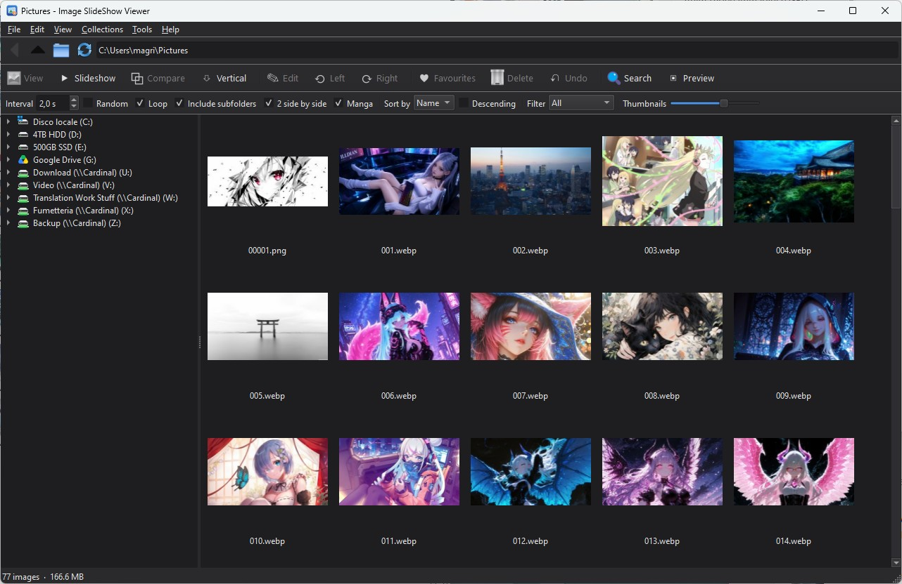

<p align="center"></p>

<h1 align="center">Image SlideShow Viewer</h1>

<p align="center">
An ACDSee-style image viewer for Windows, macOS and Linux: folder tree and thumbnail browser,
full-screen viewer, a slideshow that jumps from folder to folder, comics (CBZ, CBR, CB7),
ratings and collections, quick edits and batch operations.<br>
<b>English</b> · <a href="README.it.md">Italiano</a>
</p>

---



---

## What's new in version 2.0

- **Reorganised menus, toolbar and right-click menus**: every command has the same name and the same key in all three places, and buttons and items disable themselves when they don't apply.
- **Viewer**: rotate and flip (can be saved to the file, lossless for JPEG), fit to window / width / height / fill, magnifier, black / grey / white / checkerboard background, histogram, pixel colour (eyedropper).
- **Slideshow**: transitions (fade, slide, Ken Burns), background music, screen choice, on-the-fly sorting with keys 1–9, quick delete that Ctrl+Z undoes.
- **Comics and manga**: **CBR/RAR** and **CB7/7Z** archives besides CBZ/ZIP, conversion to CBZ, resume from the last page read, double pages shown on their own, **continuous vertical reading** (webtoon).
- **Organising**: **star ratings**, **colour labels**, **Favourites and collections**, browser filter, **search**, **find duplicates** (identical or similar), **calendar** by date taken, **map** of geotagged photos, **preview pane**.
- **Quick edits**: crop with fixed aspect ratios, brightness / contrast / saturation / sharpness, automatic correction, resize.
- **Compare** two images, side by side with synchronised zoom or with a slider.
- **Formats**: read and write **HEIC, AVIF and JPEG XL**, preview of camera **RAW** files, **short videos** (MP4, WebM, MOV…) that behave like GIFs.
- **Customisable keys**, **screensaver**, automatic GitHub builds for **Windows, macOS and Linux**.

## Features

- **Browser** with folder tree and thumbnail grid (cached on disk), natural sorting by name, date or size, filter by rating / label / Favourites / type, preview pane.
- **Viewer** with fit to window, width or height, fill the screen, zoom, automatic EXIF rotation, manual rotate and flip, magnifier, histogram, eyedropper, **animated GIF and WebP** and **video**.
- **Slideshow** with interval, random order, repeat, subfolders and transitions; **↓ / ↑ jump to the next / previous folder** while it runs.
- **Comics**: CBZ/ZIP, CBR/RAR and CB7/7Z archives shown as folders with their cover, **2 pages side by side**, **manga mode**, continuous vertical reading.
- **Ratings, labels, Favourites and collections**, search, duplicates, calendar and map.
- **Batch rename** modelled on ACDSee, **batch conversion** (JPEG, PNG, WebP, AVIF, HEIC, JPEG XL, TIFF, BMP, GIF), **copy / move / delete** with undo.
- **Image info and EXIF**, with the GPS location on a map.
- **Side-by-side slideshow of two different folders**.
- **Explorer context menu** (optional) and **network folders** (`\\192.168.0.2`).
- **GPU acceleration** (OpenGL) and optional JPEG decoding on NVIDIA GPUs.
- **English and Italian** interface, light / dark / automatic theme.

## Requirements

- Windows 10 or 11, macOS 12 or later, or Linux (X11 or Wayland)
- Python **3.11 or later** (tested with 3.14)
- The libraries in `requirements.txt`: [PySide6](https://pypi.org/project/PySide6/) 6.8+, [Pillow](https://pypi.org/project/Pillow/) 11.3+ (EXIF, editor, AVIF), [pillow-heif](https://pypi.org/project/pillow-heif/) (HEIC), [pillow-jxl-plugin](https://pypi.org/project/pillow-jxl-plugin/) (JPEG XL), [rawpy](https://pypi.org/project/rawpy/) (RAW), [py7zr](https://pypi.org/project/py7zr/) (7Z/CB7), [rarfile](https://pypi.org/project/rarfile/) (RAR/CBR), [numpy](https://pypi.org/project/numpy/). All except PySide6 are optional: if one is missing, only that format or feature is missing.
- For **CBR/RAR**: [7-Zip](https://www.7-zip.org) installed (recommended, also reads RAR5) or UnRAR.
- With an NVIDIA card (Windows and Linux): the support for decoding JPEGs on the GPU **is downloaded by the program**, which offers it on first start (see *GPU acceleration*).

## Installation

**Ready-made version.** The [Releases](https://github.com/LainX84/ImageSlideShowViewer/releases) page has packages for Windows (`.zip`), macOS (`.dmg`, Apple Silicon and Intel) and Linux (`.tar.gz`): extract and run `ImageSlideShowViewer`. On macOS, the first time right-click the app → *Open*, because it isn't signed by an Apple developer.

**From source.**

1. Install **Python 3.11 or later** from [python.org](https://www.python.org/) (on Windows tick *"Add Python to PATH"*).
2. Download or clone this repository.
3. Double-click **`image_slideshow_viewer.pyw`**. On first run it offers to install the libraries (a few minutes), then opens the program. With `.pyw` no black console window appears; if something goes wrong you get an error message and the details are in `image-slideshow-viewer-error.log`.

From a terminal:

```
pip install -r requirements.txt
python image_slideshow_viewer.pyw                 (opens the browser)
python image_slideshow_viewer.pyw D:\Photos       (opens the browser on a folder)
python image_slideshow_viewer.pyw photo.jpg       (opens the viewer straight away)
python image_slideshow_viewer.pyw comic.cbz       (opens the archive as a comic)
python image_slideshow_viewer.pyw --slideshow D:\Photos D:\Comics\vol1.cbr
python image_slideshow_viewer.pyw --screensaver D:\Photos
python image_slideshow_viewer.pyw --rename  file1.jpg file2.jpg …
python image_slideshow_viewer.pyw --convert file1.png file2.png …
```

### Building the program (.exe / .app) and making it the default photo viewer

1. On Windows double-click **`build_exe.bat`**; on macOS and Linux run **`./build.sh`**. Both use `packaging/ImageSlideShowViewer.spec` and create the `dist/` folder (on Windows `dist\ImageSlideShowViewer\ImageSlideShowViewer.exe`, on macOS `dist/Image SlideShow Viewer.app`).
2. On Windows move the whole `dist\ImageSlideShowViewer` folder (not just the .exe, which needs the `_internal` subfolder) wherever you like, for example `C:\Program Files\ImageSlideShowViewer`.
3. In Explorer right-click a .jpg, then *Open with → Choose another app → Look for another app on this PC*, select `ImageSlideShowViewer.exe` and tick *"Always use this app"*. Repeat for .png, .gif, .heic, .cbz, .cbr and so on.

From then on, double-clicking a photo opens the viewer. **Enter** takes you to the browser on that folder, just like ACDSee.

### Automatic builds on GitHub

The `.github/workflows/build.yml` workflow builds the program for **Windows x64, macOS Apple Silicon, macOS Intel and Linux x64** with Python 3.14 and PyInstaller:

- on every push and pull request it checks that the code compiles and that the program starts;
- *Actions → Build → Run workflow* creates the packages, found in the run's *Artifacts*;
- a **tag** starting with `v` also publishes them as a **Release**:

```
git tag v2.0.0
git push origin v2.0.0
```

## Explorer context menu

*Tools → Explorer context menu* adds an **Image SlideShow Viewer** submenu to Explorer:

| Right-click on | Commands |
|---|---|
| A folder, a drive or the empty area of a folder | Start slideshow |
| A `.cbz` / `.zip` / `.cbr` / `.rar` / `.cb7` / `.7z` archive | Start slideshow, Batch rename |
| An image (also HEIC, AVIF, JXL, RAW) or a video | Start slideshow, Batch rename, Convert format |

- With several items selected, a single window opens with all of them (for example one slideshow over all the selected folders, one in a row).
- The entries are written only for the current user (`HKEY_CURRENT_USER\Software\Classes`): no administrator rights are needed, and unticking the same menu item removes them completely.
- On Windows 11 the submenu is under **"Show more options"** (or Shift+F10).
- If you move the program or switch from the `.pyw` to the `.exe`, the entries are updated the next time you open the program. Changing the language updates them too.

## Browser

On the left is the folder tree, in the middle the grid (subfolders and archives with their cover first, then images and videos), on the right or at the bottom the **preview pane** (F3). Double-click or Enter on a folder to open it, Backspace to go up. Thumbnails are cached on disk and the folder refreshes by itself when files change.

**Menus, toolbar and right-click menu use the same commands**, with the same name and key. A command that can't be used (for example *Compare* without two selected images, or *Paste* with an empty clipboard) is disabled everywhere.

| Menu | Contents |
|---|---|
| **File** | Open folder, New folder, Show in Explorer, Print, Properties, Exit |
| **Edit** | Undo, Cut / Copy / Paste, Select all, Rename, Edit image, Rotate and flip (in the file), Rating, Label, Favourites, Copy to / Move to, Move to the Recycle Bin, Copy path, Desktop background |
| **View** | View, Slideshow, 2-folder slideshow, Vertical reading, Compare, Preview pane and its position, Sort by, Filter, Image info, Refresh |
| **Collections** | Favourites and the other collections, Add selection to…, New / Rename / Delete collection |
| **Tools** | Batch processing (Rename, Convert format, Convert archive to CBZ), Search, Find duplicates, Calendar, Photo map, Options, Keyboard shortcuts, Explorer menu, Language, Theme |
| **Help** | Keyboard shortcuts (always matching the keys you set), About |

The **toolbar** has the most used commands: View, Slideshow, Compare, Vertical, Edit, Rotate ⟲ ⟳, Favourites, Delete, Undo, Search, Preview. With *View → Toolbar* (or right-clicking the toolbar) you can choose **small, medium or large buttons** (bigger icons with the text below) or hide it; the icons follow the colour of the light or dark theme. The bar below has the slideshow options, sorting, the **filter** (all, by number of stars, not rated, by label, Favourites, images only, videos only) and the thumbnail size.

Thumbnails show the **stars**, a dot in the **label** colour, a heart for **Favourites** and a ▶ symbol on **videos**. When a single animated GIF / WebP is selected, its thumbnail animates.

**Network:** in the path bar you can type `\\192.168.0.2` (or the computer name) to see its shared folders, or go straight to `\\192.168.0.2\Photos`. If the computer asks for a password, sign in once from Explorer first.

| Key | Action |
|---|---|
| Enter / double-click | Open the folder or the image |
| F5, Ctrl+S | Slideshow |
| Shift+F5 | Side-by-side slideshow of 2 folders |
| Ctrl+L | Continuous vertical reading |
| Ctrl+K | Compare 2 images |
| F3 | Preview pane |
| Ctrl+E | Edit image |
| Ctrl+Alt+→ / ← | Rotate right / left (in the file) |
| Ctrl+0 … Ctrl+5 | Rating from 0 to 5 stars |
| Alt+0 … Alt+5 | Label (none, red, yellow, green, blue, purple) |
| Ctrl+D | Add to / remove from Favourites |
| Ctrl+F | Search |
| Ctrl+Z | Undo the last delete / move |
| F2 / Ctrl+F2 | Rename / batch rename |
| Ctrl+Shift+C | Convert format |
| Ctrl+X / C / V | Cut / copy / paste (also with Explorer) |
| Ctrl+Shift+N | New folder |
| Ctrl+Shift+K / M | Copy to… / Move to… |
| Ctrl+P | Print |
| Alt+Enter | Image info and EXIF (on a folder: Properties) |
| Del | Move to the Recycle Bin (can be undone) |
| Backspace, Alt+↑ / Alt+← | Parent folder / Back |
| Ctrl+, | Options |
| F1 | List of shortcuts |

All keys can be changed (see *Keyboard shortcuts*).

## Viewer and slideshow

The slideshow options are in the browser bar: **Interval**, **Random**, **Loop**, **Include subfolders**, **2 side by side** and **Manga**.

- With **one folder selected** the slideshow starts from it and continues with all the other folders in the view; with **several folders selected** it shows only those, one after the other.
- With **several images selected** it shows only those; with **just one** it starts from it. In a collection, a search or with a filter on, it shows the items in the view.
- ↓/↑ always go to the next/previous folder from the one you are looking at, and **wrap around** (from the last you go back to the first). Without subfolders the jump goes to the nearest folder on disk that contains images, staying inside the top-level folder (for example `D:\Photos`) or the Pictures folder.
- With **Include subfolders** the slideshow walks the whole tree; with *Random* it shuffles both folders and photos.

**Fit.** The **W** key cycles through *fit to window*, *fit to width* (long pages start from the top, the wheel scrolls them and then moves to the next one), *fit to height* and *fill the screen*. **Z** toggles fit / 100%; Ctrl+wheel zooms and dragging pans.

**Rotation.** **R** / **Shift+R** rotate right / left, **H** / **Shift+H** flip. The rotation stays on screen only until you press **Ctrl+S**, which saves it in the file. For **JPEG** saving is **lossless**: only the EXIF orientation changes and the pixels stay identical. For other formats the image is saved again, with its EXIF data. From the browser, *Edit → Rotate and flip* rotates several files at once.

**Viewing tools.** **L** magnifier (Shift+wheel changes its zoom), **B** background colour (black, grey, white, checkerboard for transparent areas), **G** histogram, **K** colour of the pixel under the mouse (coordinates, RGB, hex), **I** information (name, size, stars, label, Favourites, rotation).

**Transitions and music.** In *Options → Slideshow* choose the transition (none, fade, slide, **Ken Burns**, i.e. slow zoom with fade) and its duration, and **background music**: a file or a folder of tracks, optionally shuffled, with a volume. The music stops when paused; **Ctrl+M** turns it off and on. The slideshow can open on a **screen of your choice** (primary, secondary or a specific one).

**On-the-fly sorting.** In *Options → Sorting* assign a folder to keys **1–9**: during the slideshow or in the viewer the key moves (or copies) the image there and goes to the next one. **Ctrl+Z** undoes.

**Quick delete.** **Del** moves the image to the Recycle Bin without asking (confirmation can be turned back on in the options) and **Ctrl+Z** puts it back, even after several deletions. Files actually go to the Recycle Bin when the program closes.

**Ratings.** **Ctrl+0…5** stars, **Alt+0…5** label, **Ctrl+D** Favourites, also during the slideshow. **E** opens the editor, **V** vertical reading.

| Key | Action |
|---|---|
| → ← , PgDn/PgUp, wheel | Next / previous image |
| **↓ ↑** , Ctrl+→ / Ctrl+← | **Next / previous folder** |
| Space / P | Start or stop the slideshow |
| S | Stop the slideshow |
| + / − | Longer / shorter interval (in the viewer: zoom) |
| Home / End | First / last image in the folder |
| D / M | 2 side by side / manga mode |
| W | Fit: window → width → height → fill |
| Z, *, 0 | Fit ↔ 100% |
| R / Shift+R, H / Shift+H | Rotate, flip (on screen) |
| Ctrl+S | Save the rotation in the file |
| L, B, G, K | Magnifier, background, histogram, pixel colour |
| I | Information |
| F, F11, double-click | Full screen |
| 1 … 9 | Sort into the folder you set |
| Ctrl+0…5 / Alt+0…5 / Ctrl+D | Stars / label / Favourites |
| Del, Ctrl+Z | Move to the Recycle Bin, undo |
| E, V | Edit image, vertical reading |
| F2, Ctrl+C, Alt+Enter | Rename, copy the image, EXIF info |
| Ctrl+M, A | Slideshow music, video sound |
| O | Options |
| Enter | Back to the browser on this image (viewer only) |
| Esc | In the slideshow: exit and return to the browser. In the viewer: close |

Moving the mouse shows a **control bar** at the bottom (start/stop, previous/next image and folder, interval, rotate, fit, Favourites, options). **Right-click** opens a menu with all the commands, grouped: *Slideshow* (transition, music, 2 side by side, manga), *View* (fit, zoom, rotate and flip, background, magnifier, histogram, eyedropper, full screen, vertical reading), *Rating*, *Label*, *Favourites*, *Add to collection*, *Sort into*, *File* (edit, rename, copy, open with, background, print, show in Explorer, copy path, EXIF), *Undo*, *Delete*, *Options*, *Keyboard shortcuts*.

### Two images side by side

With **2 side by side** ticked (or the **D** key during the slideshow) you see two images at a time, like the pages of an open book: 1-2, then 3-4, 5-6 and so on. **Double pages** (landscape images) and videos are shown on their own, so the pairs stay aligned (can be turned off in *Options → Slideshow*). ←/→ go forward and back by one pair, ↓/↑ still jump between folders.

**Manga mode.** With **Manga** ticked (or the **M** key) the pair reads right to left: 1 on the right and 2 on the left, then 3 on the right and 4 on the left. **→** goes forward and **←** goes back as usual.

## Animated GIF and WebP, videos

- **Viewer**: animations and videos start straight away, with zoom and panning as for photos.
- **Slideshow**: while it runs the first frame is shown. With one image at a time the animation starts when you pause and stops on the current frame when you resume (option *Animate GIF and WebP files in Slideshow mode*, on by default). With **two side by side** images stay still, unless *Animate … with two images side by side* is turned on: then both animate when paused.
- **Browser**: when a single animated GIF / WebP is selected its thumbnail animates; the preview pane animates GIFs and plays videos, without sound.
- **Videos** (MP4, M4V, MOV, WebM, MKV, AVI, WMV…) appear in the browser with a thumbnail and the ▶ symbol and behave like GIFs. They start without sound; **A** turns it on. They can be hidden in *Options → Slideshow*.
- It also works with animations inside archives.

## Comics and manga

- **Archives**: ZIP/CBZ (always), **7Z/CB7** (with py7zr, included in the requirements, or 7-Zip) and **RAR/CBR** (with 7-Zip installed, which also reads RAR5, or UnRAR). They appear as folders with their cover: double-click to browse them, or select them and start the slideshow. RAR and 7Z are extracted once into a temporary folder, deleted on exit.
- **Convert archive to CBZ** (*Tools → Batch processing*, or right-click): turns CBR/RAR/CB7/7Z into the most compatible format, without recompressing the images and in the same order; optionally the originals go to the Recycle Bin.
- **Last page read**: opening an archive again from the start (slideshow, vertical reading or browser) resumes from the page where you left off; **Home** goes back to the first.
- **Continuous vertical reading** (**V** in the viewer, **Ctrl+L** in the browser): pages one below the other, to scroll like a webtoon. Wheel, ↓/↑, Space/PgDn for one screen, Home/End, **+ / −** (or Ctrl+wheel) for the column width, F full screen, Esc closes.

## Organising photos

- **Ratings** from 0 to 5 stars (Ctrl+0…5) and **colour labels** (Alt+0…5: none, red, yellow, green, blue, purple), from the browser (also on several files at once) or during the slideshow.
- **Favourites and collections**: Ctrl+D adds to or removes from Favourites. From the **Collections** menu you create collections with images from different folders, open them like a folder (also for the slideshow), rename or delete them; the images stay where they are.
- **Filter** in the browser bar: by stars, label, Favourites, images only or videos only.
- **Search** (Ctrl+F): name (also with `*` and `?`), type, date range (EXIF date taken or file date), minimum size, camera, rating, label, with or without subfolders. The results appear in the browser.
- **Find duplicates**: **identical** files (same content) or **similar** images (even resized, recompressed or converted, with an adjustable threshold). In the results, with thumbnails, choose what to move to the Recycle Bin, also with *select all except the largest / the oldest*.
- **Calendar**: the photos in the folder (and subfolders) by year, month and day taken; clicking a date shows them in the browser.
- **Photo map**: the geotagged photos (of the selection or the view) on an OpenStreetMap map in your web browser, with thumbnails.

Ratings, labels, collections and last pages read are kept in a small database in the program's data folder, so the images are never modified. The data follows the files when you rename or move them with the program.

## Quick edits

*Edit image* (**E** in the viewer, **Ctrl+E** in the browser):

- **Crop** by dragging on the image, with free, original or fixed aspect ratios (1:1, 4:3, 3:2, 16:9, 5:4, 21:9 and portrait ones) and the rule of thirds.
- **Rotate and flip**.
- **Brightness, contrast, saturation, sharpness** and **automatic correction** (levels and contrast), with instant preview.
- **Resize** when saving (in pixels or percent, keeping the aspect ratio).
- **Save** overwrites keeping EXIF and colour profile; **Save as…** also lets you change format. *Undo last change* goes back.

## Comparing two images

Select two images and press **Ctrl+K** (or *View → Compare*). You can see them **side by side**, with synchronised zoom and panning, or with the **slider**, overlaid and split by a line you drag. Wheel = zoom at the mouse, drag = pan, double-click = fit / 100%, **T** switches mode, **S** swaps, Esc closes.

## Side-by-side slideshow of 2 folders

*View → Side-by-side slideshow of 2 folders…* (Shift+F5) shows two different folders (or comic archives) next to each other, one image per side. If you selected two folders in the browser they are already filled in.

- For each side choose whether it **advances automatically** with the slideshow or only **manually**. You can also start paused and start it with Space.
- There is no folder jump here: when a side reaches its last image it starts again from the first, so the folder with fewer images loops while the other one goes on.
- Optional random order, interval adjustable with + / −.

| Key | Action |
|---|---|
| → / ← | Next / previous on both sides |
| W / Q | Next / previous on the left side |
| P / O | Next / previous on the right side |
| Click / mouse wheel on a side | Next (Shift+click: previous) on that side |
| Space | Start / stop |
| X | Swap sides |
| + / − | Longer / shorter interval |
| F, I, Esc | Full screen, information, close |

Right-click shows the same commands, and lets you switch each side between automatic and manual.

## Image info (EXIF)

*View → Image Info (EXIF)…*, right-clicking an image or **Alt+Enter** (in the browser and in the viewer) open a window with a preview and:

- **File**: name, folder (or archive), size, modified and created dates.
- **Image**: format, pixel dimensions, megapixels, colour mode, DPI, colour profile, animation frames, rating, label and Favourites.
- **Shot (EXIF)**: camera, lens, date taken, shutter speed, aperture, ISO, focal length, exposure compensation, flash, orientation, software, author, copyright.
- **GPS location** with a *Show on map* button (OpenStreetMap), and the full list of **all EXIF tags**.

If the image has no EXIF data the window says so and still shows the other details. *Copy* puts everything (or the selected rows) on the clipboard; *Windows properties…* still opens the classic window. During a slideshow, playback pauses while the window is open.

## Options

*Tools → Options…* (Ctrl+,) or the **O** key in the viewer. The tabs:

- **Messages and look**: folder name on change (position, duration), other messages, "Paused" badge, text colours and size with preview, control bar.
- **Slideshow**: transition and duration, Ken Burns zoom, background music, double pages on their own, last page read in archives, videos on/off, slideshow screen.
- **Viewer**: quick delete without confirmation, video sound, magnifier zoom.
- **Animations and GPU**: animations (paused slideshow, 2 side by side, browser thumbnail), rendering method, NVIDIA GPU support (install, reinstall, remove) and JPEG decoding on the GPU.
- **Sorting**: the folders for keys 1–9, move or copy.
- **Screensaver**: see below.
- **Formats**: what is available (HEIC, AVIF, JPEG XL, RAW, video, 7Z, RAR) and how to add what is missing.

## Keyboard shortcuts

*Tools → Keyboard shortcuts…* lists all the browser and viewer commands with their keys. Double-click to change them (up to 3 alternatives); there are also *No key*, *Default* and *Restore all defaults*. If a key is already used by another command, the program tells you. Menus, control bar and help (F1) always show the keys you set.

## Screensaver

In *Options → Screensaver* you can start, after some time without using mouse and keyboard, a **random full-screen slideshow** of a folder (with its subfolders and the interval you like). It closes when you move the mouse or press a key. It works while the program is open, even minimised; from the command line: `--screensaver <folder>`.

## GPU acceleration

*Options → Animations and GPU → Image rendering* (takes effect at the next start):

| Choice | What it uses |
|---|---|
| **Automatic** (default) | The graphics card OpenGL if available; with only software OpenGL or no OpenGL, the CPU. |
| **GPU – graphics card OpenGL** | The NVIDIA, AMD or Intel OpenGL driver. |
| **Software OpenGL** | Mesa llvmpipe (open source, bundled with PySide6): only to test whether the driver is the problem. |
| **CPU only** | The method used by earlier versions. |

With OpenGL each image is uploaded once to video memory as a mipmapped texture: fitting, zoom, panning and animation frames are computed by the GPU (trilinear filtering with supersampling), without rescaling the image on the CPU again. Under the choice you can see what is in use (for example *OpenGL 4.6 – NVIDIA GeForce …*).

**JPEG decoding on NVIDIA GPUs** (Windows x64 and Linux x64, proprietary NVIDIA library). The libraries are not bundled with the program, because only people with an NVIDIA card need them:

- at start-up, if the program finds the NVIDIA driver, it offers **once** to download them: *Download and install*, *Later* (asks again at the next start) or *Don't ask again*;
- *Options → Animations and GPU → NVIDIA GPU support* shows the card found and what is installed, with **Install / Reinstall** and **Remove** buttons;
- the program downloads the official `nvidia-nvimgcodec-cu12` and `nvidia-nvjpeg-cu12` packages from PyPI (about 25 MB), checks their SHA-256 fingerprint and keeps only what is needed (the JPEG decoder for the Python version in use, about 25 MB on disk) in the program's data folder. No pip is needed, so it also works with the compiled program;
- after installation decoding turns on by itself (*Decode large JPEGs on the NVIDIA GPU*); behind a corporate proxy you can point to its certificate with the `SSL_CERT_FILE` variable.

It applies to JPEGs of 512 KB or more; if a file cannot be decoded, Qt is used as usual. Thumbnails don't need it: Qt already decodes them at reduced resolution. A recent NVIDIA driver (CUDA 12) is needed. From source you can also use `pip install "nvidia-nvimgcodec-cu12[nvjpeg]"`.

If something goes wrong with OpenGL (black windows, menus not showing in full screen), choose *CPU only*.

## Batch rename

Select the files (images and also comic archives) and press **Ctrl+F2** (or F2 with several files selected), or use *Batch → Batch rename* in the right-click menu in the browser or in Explorer. As in ACDSee, the rename is a **list of operations** applied in order: tick the ones you need, change their order with ↑ / ↓, add more with **+** (even several of the same kind) and remove them with **−**. The preview shows the new names immediately.

| Operation | What it does |
|---|---|
| **Template** | New name from a template. `*` = original name, `#` = counter (`###` → 001, 002…, or aa, ab… with letters). Fields: `{name}`, `{folder}`, `{date}`, `{time}`, `{year}`, `{month}`, `{day}`, `{width}`, `{height}` (the Italian names `{nome}`, `{cartella}`, `{data}`… work too). *Start at*: fixed value or **auto detect**, which continues a numbering already present in the folder (Photo_001…Photo_012 → starts from 013). |
| **Search and replace** | Replaces every occurrence. Options: case sensitive, include extension, regular expression (with `\1`, `\2` in the replacement). |
| **Case change** | Name: lowercase, UPPERCASE, Title Case, Sentence case. Extension: lowercase or uppercase (to unify .JPG and .jpg). |
| **Insert text** | Prefix, suffix, after N characters, after or before a text. Options: right to left, overwrite characters, include extension, case sensitive. The text may contain the template fields. |
| **Remove text** | Starts from a position or a delimiter and removes a number of characters, up to a delimiter or to the end. Options: right to left, remove the delimiters too, include extension, case sensitive. |
| **Strip spaces** | Remove all spaces, remove leading and trailing spaces, collapse double spaces, or replace spaces with a character. |

**Advanced**

- *If the new name already exists*: rename nothing and mark them in red, skip those files, or add a number (`name (2)`, `name (3)`…).
- *If the extension changes*: allow or skip those files.

Invalid names for Windows (characters `< > : " / \ | ? *`, trailing dot or space, reserved names such as `CON`) are always marked. Swaps such as 1→2, 2→3 are handled correctly, and case-only changes (`IMG.JPG` → `img.jpg`) work too. The operations you used are remembered for next time.

## Other batch operations

- **Convert**: save as **JPEG, PNG, WebP, AVIF, HEIC, JPEG XL, TIFF, BMP or GIF**, with adjustable quality, **lossless** mode (WebP, AVIF, HEIC, JPEG XL) and longest-side reduction, into a subfolder, another folder or next to the originals. Photos are straightened according to EXIF and **EXIF data and the colour profile are kept**. Optionally, after conversion the originals go to the Recycle Bin.
- **Convert archive to CBZ**: see *Comics and manga*.
- **Copy / Move** (whole folders too): if a file already exists in the destination, you can add a number to the name, overwrite or skip it.
- **Delete**: moves files or folders to the Recycle Bin; **Ctrl+Z** undoes.

## Light / dark theme

*Tools → Theme*: **Automatic** (follows the system theme, even while the program is open), **Light** or **Dark**. The change is immediate. The viewer and the slideshow use the background chosen with the B key.

## Language

*Tools → Lingua / Language*: **Automatic** (like the system), **Italiano** or **English**. The program offers to restart to apply the change.

Translations are in `isv/lang_en.py`: the keys are the Italian strings used in the code. To add a language, create a similar dictionary and register it in `LANGUAGES` in `isv/i18n.py`.

## Formats

| | Read | Write (convert, save) |
|---|---|---|
| JPEG, PNG, GIF (also animated), WebP (also animated), BMP, TIFF | ✓ | ✓ |
| ICO, TGA | ✓ | |
| HEIC / HEIF | ✓ with pillow-heif | ✓ with pillow-heif |
| AVIF | ✓ with Pillow 11.3+ | ✓ with Pillow 11.3+ |
| JPEG XL | ✓ with pillow-jxl-plugin | ✓ with pillow-jxl-plugin |
| RAW (CR2, CR3, NEF, ARW, DNG, ORF, RW2, RAF, PEF…) | embedded preview (better with rawpy) | |
| Video (MP4, M4V, MOV, WebM, MKV, AVI, WMV, MPG, 3GP) | ✓ with QtMultimedia (part of PySide6) | |
| ZIP/CBZ archives | ✓ | ✓ (convert to CBZ) |
| 7Z/CB7 archives | ✓ with py7zr or 7-Zip | |
| RAR/CBR archives | ✓ with 7-Zip or UnRAR | |

Photos are rotated automatically according to EXIF. *Options → Formats* shows what is available on your computer.

## Project structure

```
image_slideshow_viewer.pyw   start-up (double-click)
build_exe.bat, build.sh      build the program with PyInstaller
packaging/                   PyInstaller configuration, Linux .desktop file
.github/workflows/build.yml  automatic Windows / macOS / Linux builds and Releases
isv/__init__.py              name, version, author
isv/app.py                   start-up, command line, window coordination, screen, screensaver
isv/browser.py               main window: tree, thumbnails, menus, toolbar, right-click menu
isv/shortcuts.py             list of commands and keys (customisable), F1 help
isv/thumbs.py                thumbnails, disk cache, stars / labels / videos
isv/preview.py               browser preview pane
isv/viewer.py                viewer and slideshow (commands, menus, sorting, music)
isv/canvas.py                drawing: fit, zoom, transitions, magnifier, histogram (CPU and OpenGL)
isv/gpu.py, gpudecode.py     GPU acceleration, JPEG decoding on NVIDIA GPUs
isv/nvsupport.py             on-demand NVIDIA support (detection, installation)
isv/anim.py, video.py        animated GIF / WebP, videos, slideshow music
isv/codecs.py                formats: Qt, Pillow (HEIC, AVIF, JXL), RAW, video; writing
isv/archive.py               ZIP/CBZ, RAR/CBR, 7Z/CB7 archives; conversion to CBZ
isv/orient.py                rotations, lossless JPEG
isv/edit.py                  quick edits (crop, adjustments, resize)
isv/compare.py               comparing two images
isv/webtoon.py               continuous vertical reading
isv/library.py               ratings, labels, collections, last page read (SQLite)
isv/undo.py                  undoable delete and sorting
isv/search.py, duplicates.py search, duplicates
isv/timeline.py, gpsmap.py   calendar, photo map
isv/exifutil.py              date taken, camera, GPS
isv/screensaver.py           screensaver (system idle time)
isv/dual.py                  side-by-side slideshow of 2 folders
isv/navigator.py             image and folder navigation logic
isv/batch.py                 rename / convert / copy / move / delete dialogs
isv/rename.py                rename engine (no Qt, testable on its own)
isv/fileops.py               clipboard, open with, wallpaper, print, properties, rename
isv/imageinfo.py             image info and EXIF
isv/shell.py                 Explorer context menu (registry)
isv/single.py                gathers the files selected in Explorer into one window
isv/options.py               Options dialog
isv/about.py, theme.py       About dialog, light / dark theme
isv/i18n.py, lang_en.py      translations
isv/loader.py, worker.py     image loading and preloading, background jobs
isv/utils.py                 file listing, sorting, folder navigation
```

Settings are saved automatically (on Windows in the registry, under `HKCU\Software\LainX84\ImageSlideShowViewer`); ratings, collections and last pages read in the `library.sqlite3` file in the program's data folder. On first run the settings of the previous version (FotoVista) are imported.

## Author

**LainX84** — [github.com/LainX84](https://github.com/LainX84)

## License

MIT — see [LICENSE](LICENSE).
